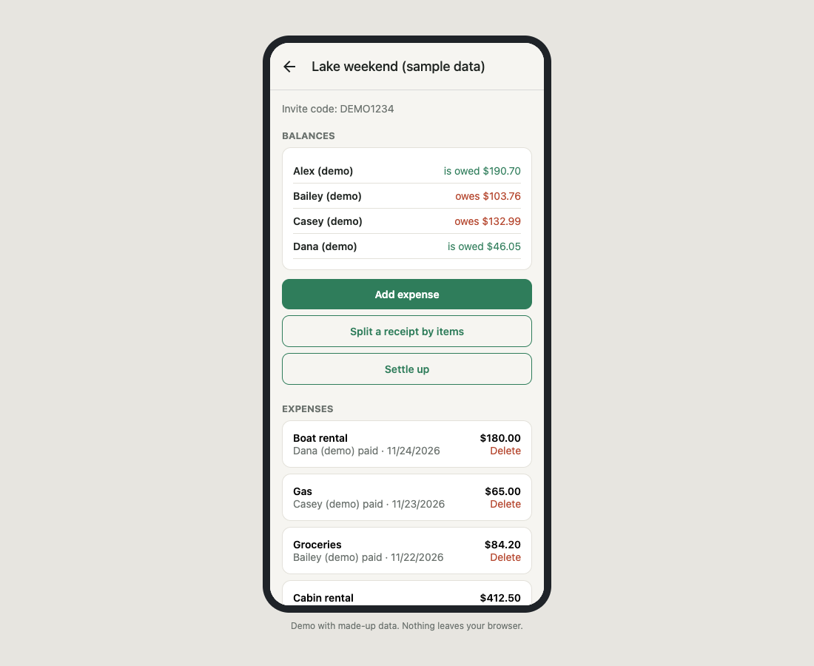

# Demo mode



**Try it:** https://andyhetianjun.github.io/tabby/

Tabby normally needs its server. Demo mode runs the whole app without one: the groups, expenses, balances and settle-up all happen on your own device, and the data is saved in the browser's (or phone's) local storage. It starts with a made-up group, "Lake weekend (sample data)", with four people marked "(demo)" and one expense of each split type, so you can tap through straight away.

Things to try: add an expense and switch between Equally, Exact amounts, Shares and Percent; open the group to see who owes whom; tap "Settle up" and "Mark as paid"; use "Reset demo data" on the first screen to start over.

## Why I added this

To try the first version you had to start a server, create an account and add people before seeing anything. I also wanted to check that the splitting code in `packages/core` really does not depend on the server. Running it directly on the device is a good test of that.

## How it works

The app talks to the server through one object (`createClient`, in `apps/mobile/src/api/client.ts`). `createLocalClient` (`src/api/localClient.ts`) has the same methods, but instead of sending requests it reads and writes one JSON document in local storage. It uses the same core code as the server for splitting, balances and settle-up, and the same request checks (the zod schemas in `core`), so a bad request is refused in the same way. The screens do not know which one they are using.

A few details:

- Calls run one at a time, so two quick taps cannot overwrite each other. A call that fails leaves the saved data as it was.
- Results are copies, so a screen holding old data never sees it change underneath it.
- Sending the same `clientId` twice saves one expense, like the server does.
- The sample group is built by `src/api/demoSeed.ts` using the real split code, so its numbers are correct.

## How to try it

Online: open the link above. On a wide screen the app is shown inside a phone-sized frame; on a phone it fills the screen.

On your computer, with no server:

```bash
cd apps/mobile
EXPO_PUBLIC_DEMO_ONLY=1 npx expo start --web
```

Or run the app as usual (`npm run dev:mobile`) and press "Try the demo" on the sign-in screen.

The public site is built by `.github/workflows/pages.yml`:

```bash
cd apps/mobile
EXPO_PUBLIC_DEMO_ONLY=1 EXPO_BASE_URL=/tabby npx expo export --platform web --output-dir dist
```

`EXPO_BASE_URL` matters because the site is served from `/tabby/`, not from the top of the domain.

## What I checked

- `npm test -w @tabby/mobile`: 15 of the 32 tests are new. 13 are for the local data layer (sample group is balanced and has all four split types, changes persist across clients, all four split types, rejected input, duplicate `clientId`, settling brings everyone to zero, delete, overlapping calls, failed changes are not half-saved, reset, join by code).
- I built the site with the command above, served it from a `/tabby/` folder and drove it in headless Chrome: open the group, add an equal expense, add a receipt, mark every suggested payment as paid and see "Everyone is settled up". It worked; the screenshot above comes from that run.

## Limits

- It is one device only. Nothing syncs, and clearing the browser's site data clears the demo.
- Demo mode has no accounts, so "Join with a code" only finds groups already on the device.
- I have not run it on a physical phone or a simulator.
