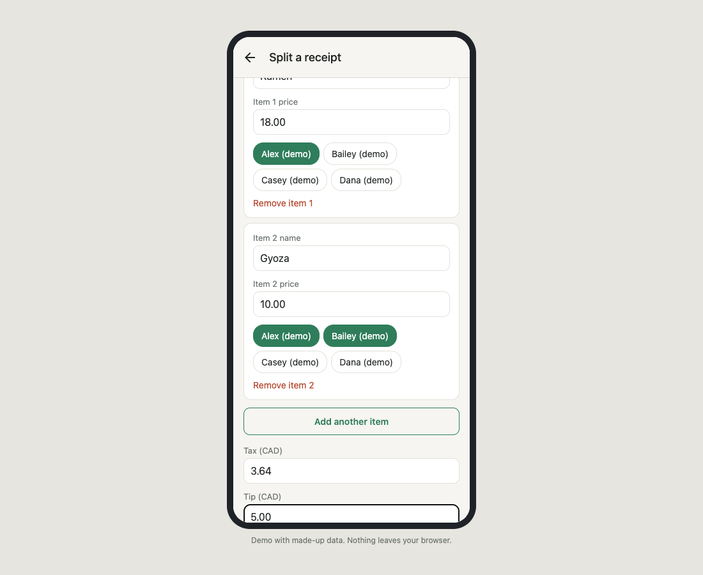

# Splitting a receipt by items



Equal splits are wrong for a restaurant bill when one person had the steak and another had water. In the app, open a group and tap "Split a receipt by items". Add each item with its price, tap the names of everyone who shared it, then enter the tax and tip. Tabby shows what each person owes (items, tax and tip) before you save, and saves it as one normal expense.

## Why I added this

The first version could only split a single amount. The most common real case is a bill with several items, tax and a tip, and I wanted to see how to do the rounding properly when there are many small divisions instead of one.

## How it works

The code is `splitReceipt` in `packages/core/src/receipt.ts`.

1. Each item is divided evenly between the people who shared it, using the same cent-by-cent rule as the other splits. When an item does not divide evenly (for example $1.01 between two people), the spare cent goes to a different person for each item, because the starting person rotates with the item's position. Nobody always pays the extra cent.
2. Tax and tip are each shared in proportion to what a person's items came to. The proportion is measured on the exact shares before rounding, so one shared cent cannot push a whole tip onto one person. (My first version used the rounded amounts, and a property test found this: a 1 cent item shared by two people made a $0.06 tip go 6 cents to one person and 0 to the other.)
3. The people's totals are added up and checked. They always equal items + tax + tip exactly.

The result is stored as a normal expense with "exact amounts", so the server, the balances and settle-up needed no changes.

Example (in `packages/core/test/receipt.test.ts`): pasta $18.00 (Alex), salad $12.00 (Bailey), a $10.00 starter shared, tax $4.00, tip $6.00. Alex pays $28.75 and Bailey $21.25, which is $50.00.

## How to try it

In the [live demo](https://andyhetianjun.github.io/tabby/), or in code:

```ts
import { splitReceipt } from "@tabby/core";

splitReceipt({
  items: [
    { name: "Pasta", amount: 1800, memberIds: ["alex"] },
    { name: "Starter", amount: 1000, memberIds: ["alex", "bailey"] },
  ],
  tax: 280,
  tip: 400,
}).shares;
```

Amounts are whole cents.

## What I checked

```bash
npm test -w @tabby/core     # 41 tests, 7 of them new
npm test -w @tabby/mobile   # includes the receipt form tests
```

The property tests generate 300 random receipts each (up to 15 items, up to 5 people, items shared by any group of them, in any order, with tax and tip up to $200). For every receipt they check:

- the people's totals add up to the receipt total, and so do items, tax and tip taken separately
- nobody is more than one cent per item plus two cents away from their exact share
- only people named on an item appear, and nobody pays less than their own items

## Limits

- Items are shared evenly between the people on them. Uneven sharing of one item is not supported yet.
- Tax and tip are entered as amounts, not percentages.
- There is no photo scanning. You type in the items.
